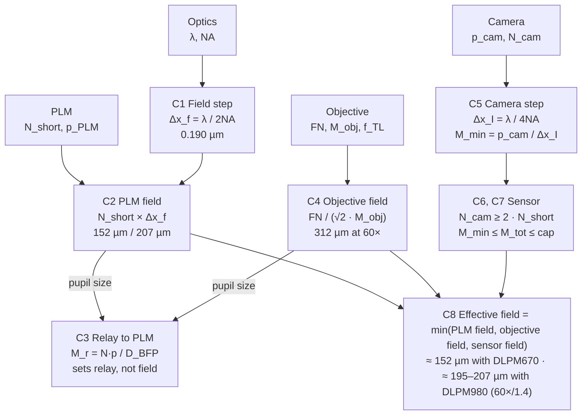

# Sampling Constraints for PLM-Based Pupil Engineering at NA 1.4

Oct 28, 2026 · Borys

With an NA 1.4 objective, the effective field of view is set by the PLM's pupil sample count, not by magnification. It is about 152 µm for the DLPM670 and about 207 µm for the DLPM980. Magnification only decides whether the objective's field number and the camera can carry that field at Nyquist.

## Assumptions

- **Objective:** NA = 1.4 (oil immersion), field number FN = 26.5 mm, tube lens f_TL = 200 mm. Nominal magnifications of 60× and 100× are used as examples.
- **Wavelength:** λ = 532 nm. Every lateral length scales ∝ λ, so detection-path figures should be recomputed at the emission wavelength.
- **PLM in a pupil-conjugate plane**, one PLM pixel per pupil sample, with the circular pupil inscribed in the short axis of the array. Anamorphic relays are out of scope.
- **DLPM670:** TI 0.67" PLM, 1358 × 800 pixels, 10.8 µm pitch, 4-bit, up to 1.44 kHz.
- **DLPM980:** TI 0.98" PLM, 2048 × 1088 pixels, 10.8 µm pitch, 4-bit, above 5 kHz.
- **Cameras:** pixel pitches of 2.74, 3.45, 5.86, 6.5 and 11 µm; a 2048-pixel short axis is the reference sensor.

## How the constraints connect

NA fixes two Nyquist steps: the field step drives the PLM-limited field, and the half-size intensity step drives camera magnification. The objective's FN and the sensor width then decide whether that field survives to the image; the relay to the PLM only matches pupil size.

## Constraints and formulas

### C1. Field Nyquist step

The pupil passes spatial frequencies up to NA/λ. The complex field in the sample is therefore band-limited, and its Nyquist step is set by NA alone. At NA 1.4 and 532 nm this is 0.190 µm.

$$
\Delta x_{f} = \frac{\lambda}{2\,\mathrm{NA}}
$$

### C2. PLM-limited field of view

A pupil sampled with N pixels resolves a frequency step of 1/FOV, so the field it can address without aliasing is N field steps wide. The same value is the largest lateral extent an engineered PSF can occupy. It does not depend on magnification.

$$
\mathrm{FOV}_{PLM} = N_{short}\,\Delta x_{f} = N_{short}\,\frac{\lambda}{2\,\mathrm{NA}}
$$

A practical design keeps a margin for alignment and edge apodization. With fill factor η ≈ 0.9 of the short axis, FOV_PLM shrinks to η × N × Δx_f.

### C3. Pupil diameter and relay to the PLM

The back focal plane diameter follows from NA and the objective focal length. A relay of magnification M_r maps it onto the PLM short axis. This constraint sets the relay, not the field.

$$
D_{BFP} = 2\,\mathrm{NA}\,f_{obj} = \frac{2\,\mathrm{NA}\,f_{TL}}{M_{obj}}, \qquad M_{r} = \frac{N_{short}\,p_{PLM}}{D_{BFP}}
$$

### C4. Objective field number

The objective delivers a circular field of diameter FN/M_obj, where M_obj is the nominal magnification. The square PLM field must fit inside that circle, which caps M_obj.

$$
\mathrm{FOV}_{obj} = \frac{\mathrm{FN}}{M_{obj}}, \qquad M_{obj} \le \frac{\mathrm{FN}}{\sqrt{2}\,\mathrm{FOV}_{PLM}}
$$

### C5. Camera Nyquist: minimum total magnification

The camera records intensity, whose spectrum is the autocorrelation of the pupil and extends to 2NA/λ. Its Nyquist step is half the field step, 95 nm here. M_tot is the total magnification at the sensor, objective plus any relay.

$$
\Delta x_{I} = \frac{\lambda}{4\,\mathrm{NA}}, \qquad M_{tot} \ge M_{min} = \frac{p_{cam}}{\Delta x_{I}} = \frac{4\,\mathrm{NA}\,p_{cam}}{\lambda}
$$

### C6. Camera pixel count

Covering the PLM field at intensity Nyquist needs twice as many camera pixels per axis as there are PLM pupil samples.

$$
N_{cam} \ge \frac{\mathrm{FOV}_{PLM}}{\Delta x_{I}} = 2\,N_{short}
$$

### C7. Maximum useful magnification

Magnification above M_min adds no information: photons per pixel fall as 1/M_tot². A sampling margin of about 2× helps deconvolution and PSF calibration and sets a soft ceiling. The sensor sets a hard ceiling, because its width must still cover the PLM field.

$$
M_{min} \le M_{tot} \le \min\left(2\,M_{min},\; \frac{N_{cam}\,p_{cam}}{\mathrm{FOV}_{PLM}}\right)
$$

### C8. Effective field of view

The usable square field is the smallest of the three limits. A feasible design needs M_tot inside the C7 window; if the window is empty, the sensor cannot hold the PLM field at Nyquist.

$$
\mathrm{FOV}_{eff} = \min\left(\mathrm{FOV}_{PLM},\; \frac{\mathrm{FN}}{\sqrt{2}\,M_{obj}},\; \frac{N_{cam}\,p_{cam}}{M_{tot}}\right)
$$

## Worked calculations: DLPM670 and DLPM980

At NA 1.4 and 532 nm, Δx_f = 0.190 µm and Δx_I = 0.095 µm. The DLPM980 addresses a 1.36× wider field than the DLPM670, but at 100× its square field no longer fits inside FN 26.5.

### PLM-dependent limits

| Quantity | Constraint | DLPM670 | DLPM980 |
| --- | --- | --- | --- |
| Array, pitch | — | 1358 × 800, 10.8 µm | 2048 × 1088, 10.8 µm |
| Pupil samples N_short | — | 800 | 1088 |
| Short-axis aperture N × p (mm) | C3 | 8.64 | 11.75 |
| FOV_PLM, full fill (µm) | C2 | 152.0 | 206.7 |
| FOV_PLM, η = 0.9 (µm) | C2 | 136.8 | 186.0 |
| Max M_obj, square field inside FN (×) | C4 | 123 | 91 |
| Max M_obj, circular field inside FN (×) | C4 | 174 | 128 |
| Relay M_r, 60×/1.4 (D_BFP 9.33 mm) | C3 | 0.93× | 1.26× |
| Relay M_r, 100×/1.4 (D_BFP 5.60 mm) | C3 | 1.54× | 2.10× |
| Camera pixels per axis at Nyquist | C6 | 1600 | 2176 |
| Max M_tot, 2048 px × 6.5 µm sensor (×) | C7 | 87.6 | 64.4 |
| Max M_tot, 2048 px × 3.45 µm sensor (×) | C7 | 46.5 | 34.2 |
| Phase pattern rate | — | 1.44 kHz | > 5 kHz |

### Objective field at FN 26.5

| M_obj | Circular field FN/M (µm) | Inscribed square (µm) | Field limit, DLPM670 | Field limit, DLPM980 |
| --- | --- | --- | --- | --- |
| 60× | 442 | 312 | PLM, 152 µm | PLM, 207 µm |
| 100× | 265 | 187 | PLM, 152 µm | FN, 187 µm |

### Camera sampling window

M_min follows C5; the 2× ceiling follows C7. The relay columns give the extra magnification needed after each objective to reach M_min.

| Camera pixel (µm) | M_min (×) | 2× ceiling (×) | Relay after 60× | Relay after 100× |
| --- | --- | --- | --- | --- |
| 2.74 | 28.8 | 57.7 | 0.48× | 0.29× |
| 3.45 | 36.3 | 72.6 | 0.61× | 0.36× |
| 5.86 | 61.7 | 123.4 | 1.03× | 0.62× |
| 6.5 | 68.4 | 136.8 | 1.14× | 0.68× |
| 11 | 115.8 | 231.6 | 1.93× | 1.16× |

### Feasibility with a 2048-pixel sensor

At exactly Nyquist, a 2048-pixel axis covers 2048 × 0.095 µm = 194.6 µm, whatever the pixel pitch.

- **DLPM670:** feasible. The 152 µm field needs 1600 pixels, leaving a window from M_min up to the C7 cap (for 6.5 µm pixels, 68.4× to 87.6×).
- **DLPM980:** infeasible at full fill. The 206.7 µm field needs 2176 pixels, so the C7 window is empty (for 6.5 µm pixels, 68.4× > 64.4×). Either accept 194.6 µm (94 % of the PLM field), use a sensor with ≥ 2176 pixels on the short axis, or sample slightly below Nyquist at 64.4× (Δx = 0.101 µm).

## Design rules and recommended configuration

Use a 60×/1.4 objective and set the total magnification with a relay, because FN limits only the nominal objective magnification while Nyquist depends on the total.

1. **Fix NA first; it sets both Nyquist steps.** Field step λ/(2NA) for the PLM, intensity step λ/(4NA) for the camera. Raising NA shrinks the PLM field as 1/NA.
2. **The PLM sets the field; magnification cannot enlarge it.** FOV_PLM = N_short × λ/(2NA): 152 µm for the DLPM670, 207 µm for the DLPM980.
3. **Keep M_obj below the FN cap.** 123× for the DLPM670 and 91× for the DLPM980 keep the square field inside FN 26.5. A 60× objective satisfies both with margin.
4. **Choose the relay to the PLM from the pupil size.** About 0.93× for the DLPM670 and 1.26× for the DLPM980 behind a 60×/1.4 objective with a 200 mm tube lens.
5. **Choose the total magnification from the camera pixel.** M_tot ≥ 4NA × p_cam / λ, for example 68.4× for 6.5 µm or 36.3× for 3.45 µm pixels.
6. **Size the sensor at 2 × N_short pixels per axis.** 1600 for the DLPM670 and 2176 for the DLPM980; a 2048-pixel sensor caps the DLPM980 field at 194.6 µm.
7. **Stay close to M_min.** Every 2× of extra magnification costs 4× in photons per pixel and halves the sensor-limited field.

**Recommended effective fields with a 60×/1.4 objective:** about 150 µm with the DLPM670 (≈ 137 µm at 90 % pupil fill) and about 195–207 µm with the DLPM980, depending on whether the sensor has 2048 or ≥ 2176 pixels on its short axis.

## Sources

- [plmctrl, DLP6750 EVM library](https://github.com/structuredlightlab/plmctrl)
- [PLMs for real-time wavefront correction, arXiv 2509.05896](https://arxiv.org/html/2509.05896)
- [In-Vision development kits](https://in-vision.at/)
- Deb et al., FourierNets, arXiv 2104.10611 (project file)
